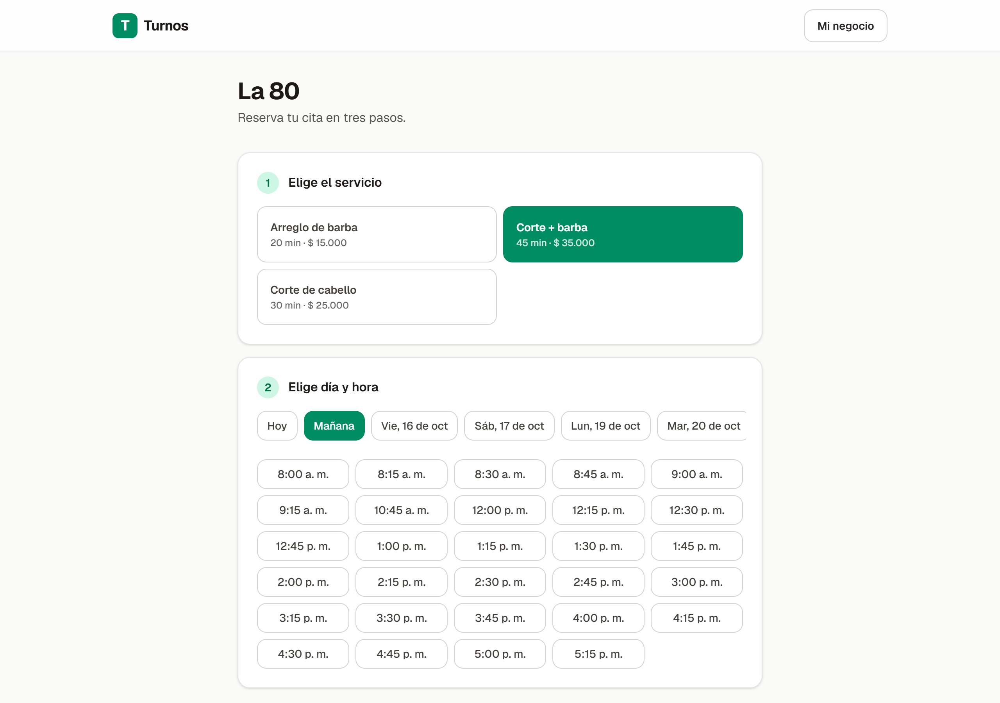
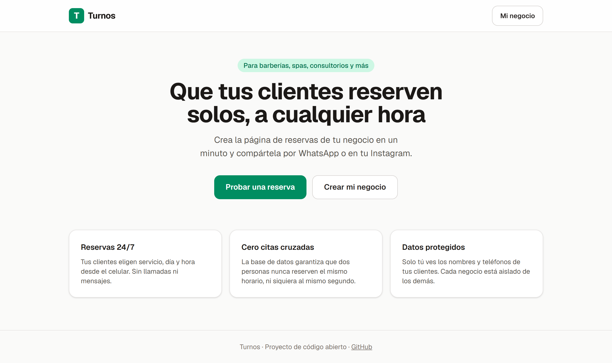
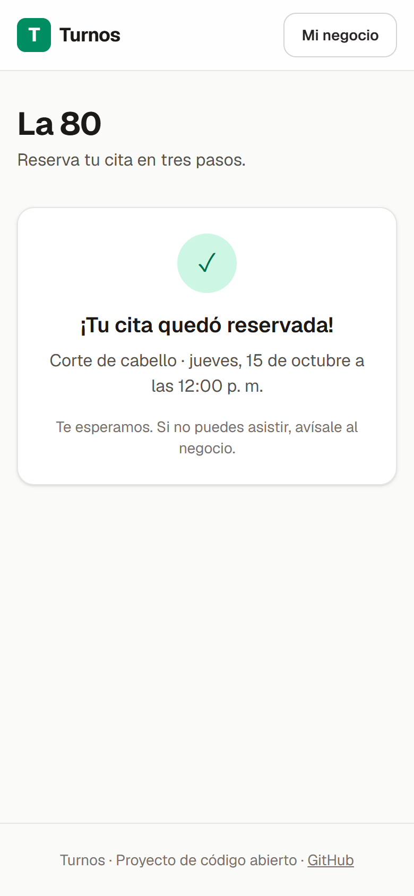

# Turnos

**Reservas en línea para negocios pequeños — barberías, spas, consultorios — hecho con Next.js 16 y Supabase.**

[](https://github.com/jdmahecha1/turnos/actions/workflows/ci.yml)


**[Demo en vivo → turnos-delta-six.vercel.app](https://turnos-delta-six.vercel.app)** · prueba una reserva en
[/b/la-80](https://turnos-delta-six.vercel.app/b/la-80) · [Read in English](README.md)

Los clientes eligen servicio, día y un horario libre, y reservan en tres pasos desde el celular.
El dueño tiene un panel con sus próximas citas, servicios y horario de atención. Lo interesante
está debajo: **la propia base de datos garantiza que dos personas nunca puedan reservar el mismo
horario**, y los datos de los clientes están protegidos con seguridad por filas (RLS) que se
prueba en cada commit.

<p align="center">
  
</p>

<p align="center">
  
  &nbsp;
  
</p>

## Lo más destacado

- **Cero citas cruzadas, incluso con concurrencia.** Una restricción `EXCLUDE USING gist` sobre
  `tstzrange(starts_at, ends_at)` rechaza citas confirmadas que se solapen, directamente en la
  base de datos. Si dos clientes pulsan el mismo horario en el mismo milisegundo, Postgres elige
  un ganador y el otro recibe un mensaje amable con la disponibilidad actualizada.
- **Seguridad por filas en todas las tablas.** Un visitante puede ver el negocio, sus servicios
  activos y su horario, pero nunca el nombre o teléfono de otro cliente. Cada dueño solo ve y
  modifica lo suyo, y puede cancelar una cita pero no moverla (`GRANT UPDATE (status)` por columna).
- **La lógica de reservas vive en la base de datos.** `available_slots()` y `book_appointment()`
  calculan y validan los horarios libres cada 15 minutos en la zona horaria del negocio. Son
  funciones `SECURITY DEFINER` guardadas en un esquema `private` que la API no expone, detrás de
  funciones públicas `SECURITY INVOKER` — el patrón que recomienda el asesor de seguridad de
  Supabase, que reporta **cero problemas**.
- **Pruebas de base de datos sin Docker.** Las migraciones reales corren en
  [PGlite](https://pglite.dev) (Postgres compilado a WebAssembly) dentro de Vitest, cambiando
  entre los roles `anon` y `authenticated` para comprobar cada política. La CI las corre en segundos.
- **Next.js 16 con Cache Components.** Las páginas envían al instante una estructura estática y
  los datos dinámicos (disponibilidad, citas del dueño) llegan por streaming dentro de `<Suspense>`.

## Comprobaciones de seguridad

Son pruebas automáticas en [`tests/db/security.test.ts`](tests/db/security.test.ts) y además se
verificaron contra la API real usando la clave pública:

| Intento                                  | Resultado                                           |
| ---------------------------------------- | --------------------------------------------------- |
| Leer `appointments` como visitante       | `[]` (RLS oculta todas las filas)                   |
| Insertar una cita directamente           | `permission denied` (solo `book_appointment` puede) |
| Llamar al esquema `private` desde la API | `Invalid schema: private`                           |
| Reservar un horario ya ocupado           | `slot_unavailable`                                  |
| El dueño A lee o edita datos del dueño B | 0 filas                                             |
| Un dueño mueve una cita a otra hora      | `permission denied` (solo el estado)                |
| `TRUNCATE` desde los roles de la API     | `permission denied` (TRUNCATE se salta RLS)         |

## Cómo ejecutarlo

1. Crea un proyecto gratis en [supabase.com](https://supabase.com) y ejecuta en orden los
   archivos de [`supabase/migrations`](supabase/migrations) (editor SQL o `supabase db push`).
2. Configura la app:

   ```bash
   git clone https://github.com/jdmahecha1/turnos && cd turnos
   npm install
   cp .env.example .env.local   # pon la URL y la clave publishable de tu proyecto
   npm run dev
   ```

3. Abre <http://localhost:3000>, crea una cuenta, crea tu negocio y comparte `/b/tu-direccion`.

## Pruebas

```bash
npm test             # pruebas unitarias y de base de datos (sin Docker ni cuenta de Supabase)
npm run lint
npm run typecheck
npm run format:check
```

## Decisiones de diseño

- **¿Por qué las reglas de reserva en Postgres?** La disponibilidad y las citas cruzadas son
  problemas de integridad de datos. Tenerlas junto a los datos hace que cualquier cliente (esta
  app, una futura app móvil o un chatbot) tenga las mismas garantías, y que una condición de
  carrera no pueda colarse por una validación de la aplicación.
- **¿Por qué horarios de 15 minutos calculados al vuelo?** No hay una tabla de horarios que
  mantener sincronizada: cambiar el horario o la duración de un servicio se refleja al instante.
- **¿Por qué un negocio por dueño?** Mantiene simples el modelo y las políticas en la primera
  versión; varias sedes requerirían una tabla de miembros.

## Licencia

[MIT](LICENSE) © Juan Diego Mahecha Martinez. Hecho con ayuda de Claude (Anthropic).
