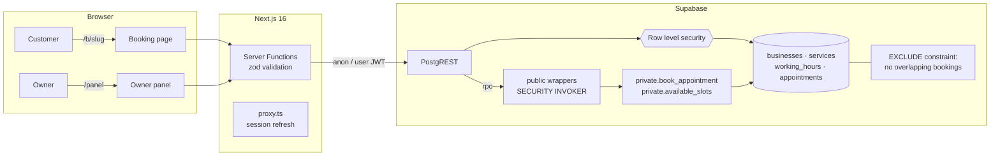

# Turnos

**Online booking for small businesses — barbershops, spas, clinics — built with Next.js 16 and Supabase.**

[](https://github.com/jdmahecha1/turnos/actions/workflows/ci.yml)


**[Live demo → turnos-delta-six.vercel.app](https://turnos-delta-six.vercel.app)** · try a booking at
[/b/la-80](https://turnos-delta-six.vercel.app/b/la-80) · [Leer en español](README.es.md)

Customers pick a service, a day and a free time slot and book in three steps from their phone.
Owners get a panel with upcoming appointments, services and opening hours. The interesting part
is underneath: **the database itself guarantees that two people can never book the same slot**,
and customers' data is protected by row level security that is tested on every commit.

<p align="center">
  
</p>

<p align="center">
  
  &nbsp;
  
</p>

## Highlights

- **No double bookings, even under concurrency.** An `EXCLUDE USING gist` constraint on
  `tstzrange(starts_at, ends_at)` rejects overlapping confirmed appointments at the database level.
  If two customers click the same slot in the same millisecond, Postgres picks a winner and the
  other one gets a friendly "that slot was just taken" message with refreshed availability.
- **Row level security on every table.** Visitors can read a business, its active services and
  hours, but never another customer's name or phone. Owners only see and change their own data,
  and can cancel an appointment but not move it (column-level `GRANT UPDATE (status)`).
- **Booking logic in the database.** `available_slots()` and `book_appointment()` compute and
  validate free 15-minute slots in the business' timezone. They are `SECURITY DEFINER` functions
  kept in a `private` schema the API doesn't expose, behind thin `SECURITY INVOKER` wrappers —
  the pattern recommended by the Supabase security advisor, which reports **zero issues**.
- **Database tests without Docker.** The real migrations run in [PGlite](https://pglite.dev)
  (Postgres compiled to WebAssembly) inside Vitest, switching between the `anon` and
  `authenticated` roles to prove each policy. CI runs them in seconds.
- **Next.js 16 with Cache Components.** Pages ship a static shell instantly and stream the
  dynamic parts (availability, the owner's appointments) inside `<Suspense>`.

## Architecture



The app never uses a service-role key: every query runs as the visitor or the signed-in owner,
so the database is the single place that decides who can see or change what.

## Security checks

These are automated tests in [`tests/db/security.test.ts`](tests/db/security.test.ts) and were
also verified against the live API with the public key:

| Attempt                                    | Result                                            |
| ------------------------------------------ | ------------------------------------------------- |
| Read `appointments` as a visitor           | `[]` (RLS hides every row)                        |
| Insert an appointment directly             | `permission denied` (only `book_appointment` can) |
| Call the `private` schema through the API  | `Invalid schema: private`                         |
| Book a slot that is already taken          | `slot_unavailable`                                |
| Owner A reads or edits owner B's data      | 0 rows                                            |
| Owner moves an appointment to another time | `permission denied` (status only)                 |
| `TRUNCATE` from the API roles              | `permission denied` (TRUNCATE bypasses RLS)       |

## Tech stack

Next.js 16 (App Router, Server Functions, Cache Components) · React 19 · TypeScript ·
Tailwind CSS 4 · Supabase (Postgres 17, Auth, RLS) · zod · Vitest · PGlite · Playwright (screenshots)

## Running locally

1. Create a free project at [supabase.com](https://supabase.com) and run the files in
   [`supabase/migrations`](supabase/migrations) in order (SQL editor or `supabase db push`).
2. Configure the app:

   ```bash
   git clone https://github.com/jdmahecha1/turnos && cd turnos
   npm install
   cp .env.example .env.local   # fill in your project URL and publishable key
   npm run dev
   ```

3. Open <http://localhost:3000>, create an account, create your business and share
   `/b/your-slug`.

## Tests

```bash
npm test             # unit + database tests (no Docker, no Supabase account needed)
npm run lint
npm run typecheck
npm run format:check
```

| Suite                       | What it covers                                                                                                                             |
| --------------------------- | ------------------------------------------------------------------------------------------------------------------------------------------ |
| `tests/db/booking.test.ts`  | slot grid, overlaps, cancellations, closed days, 60-day window, past times, phone normalization, constraint as last line of defense        |
| `tests/db/security.test.ts` | every RLS policy and grant, as `anon` and as two different owners; no `SECURITY DEFINER` in the exposed schema; RLS enabled on every table |
| `src/lib/*.test.ts`         | timezone-aware dates, Colombian formats (COP, 12-hour clock), validation, error messages                                                   |

## Project structure

```text
supabase/migrations/     schema, RLS, booking functions (+ hardening after the advisors)
src/app/
├── page.tsx             landing
├── b/[slug]/            public booking page + Server Functions
├── panel/               owner dashboard: appointments, services, hours
├── login/               email + password auth
└── auth/confirm/        email confirmation callback
src/lib/                 Supabase clients, validation, dates, error messages
src/proxy.ts             refreshes the auth session on each request
tests/db/                PGlite harness + database tests
```

## Design decisions

- **Why put the booking rules in Postgres?** Availability and double-booking are data integrity
  problems. Keeping them next to the data means every client (this app, a future mobile app or
  a chatbot) gets the same guarantees, and a race condition can't sneak past an application check.
- **Why 15-minute slots computed on the fly?** No slot table to keep in sync: changing hours or a
  service duration is reflected immediately.
- **Why one business per owner?** It keeps the model and the RLS simple for the first version;
  multi-location support would add a `members` table.

## Roadmap

- [ ] WhatsApp / email reminders the day before
- [ ] Several staff members per business, each with their own calendar
- [ ] Customers cancel their own booking with a private link
- [ ] Rate limiting on public bookings

## License

[MIT](LICENSE) © Juan Diego Mahecha Martinez. Built with the help of Claude (Anthropic).
